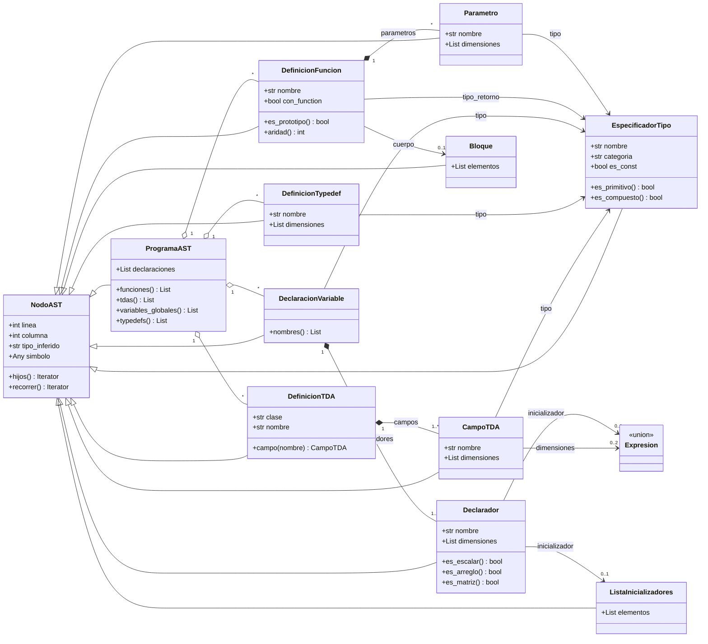
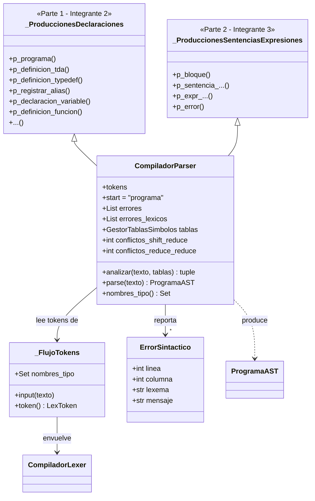
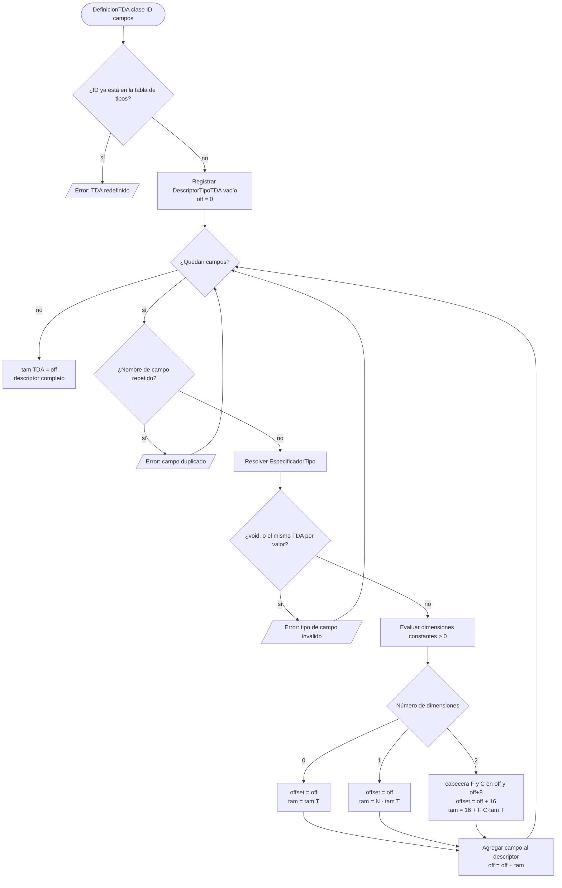
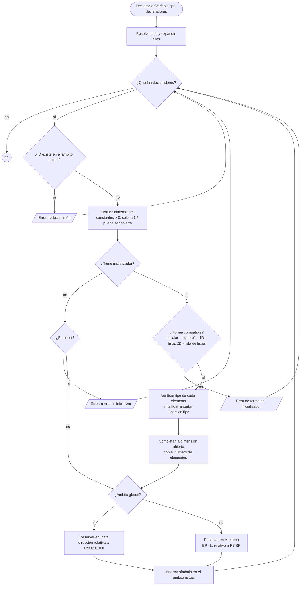
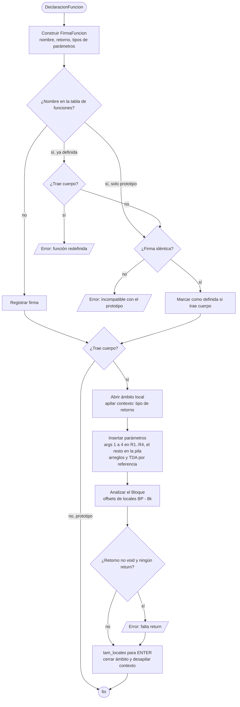
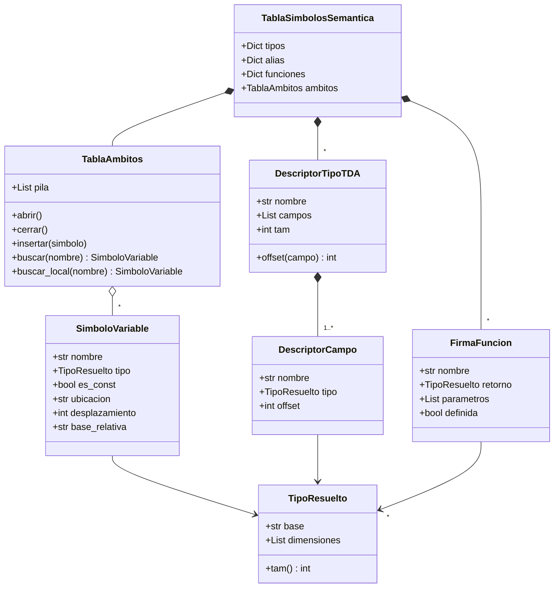

# Informe técnico: AST y analizador sintáctico, Parte 1 (declaraciones, TDA y funciones)

**Integrante 2. Taller 02, Literales d (Parte 1) y e (AST y Parser Parte 1)**

| Archivo | Contenido |
|---|---|
| `spl/compilador/ast_nodos.py` | Jerarquía completa de nodos del AST (`@dataclass` con `linea`, `columna`, `tipo_inferido` y `simbolo`), recorrido, patrón visitante y volcado en texto |
| `spl/compilador/parser.py` | Analizador LALR(1) en `ply.yacc`. Parte 1: `Programa`, `DefinicionTDA`, `DefinicionTypedef`, `EspecificadorTipo`, `DeclaracionVariable` (escalares, 1D y 2D) y `DeclaracionFuncion`. Parte 2: base mínima provisional para el Integrante 3 |
| `spl/compilador/__init__.py` | Exporta `CompiladorParser`, `ErrorSintactico`, `NodoAST`, `ProgramaAST`, `VisitanteAST` y `formatear_ast` |
| `tests/test_spl/test_parser_spl.py` | 95 pruebas |

## 1. Uso

```python
from spl.compilador import CompiladorParser, formatear_ast

parser = CompiladorParser()                 # construye la tabla LALR(1) en memoria
ast, errores = parser.analizar(texto_pre)   # texto ya preprocesado (.pre)
print(formatear_ast(ast))
parser.tablas            # GestorTablasSimbolos que llenó el lexer
parser.errores_lexicos   # List[ErrorLexico]
```

Desde la consola (preprocesa el `.spl` y muestra el árbol):

```
python -m spl.compilador.parser spl/compilador/ejemplos/escenario1_tda_matrices.spl
```

Salida abreviada para `struct Punto { float x; int m[2][3]; };`:

```
ProgramaAST  @1:1
└─ declaraciones[0]: DefinicionTDA(clase='struct', nombre='Punto')  @1:1
   ├─ campos[0]: CampoTDA(nombre='x')  @1:16
   │  └─ tipo: EspecificadorTipo 'float'  @1:16
   └─ campos[1]: CampoTDA(nombre='m')  @1:25
      ├─ tipo: EspecificadorTipo 'int'  @1:25
      ├─ dimensiones[0]: LiteralEntero(valor=2, lexema='2')  @1:31
      └─ dimensiones[1]: LiteralEntero(valor=3, lexema='3')  @1:34
```

## 2. Contrato de entrada y salida (etapa 3 de la Matriz de Modularidad)

| | |
|---|---|
| **Entrada** | Texto del `.pre`. El parser crea un `CompiladorLexer` por análisis y lee de él el flujo `List[LexToken]` con `type`, `lineno`, `columna` y `simbolo_idx` |
| **Transformación** | Autómata LALR(1) generado por `ply.yacc`: **0 conflictos shift/reduce y 0 reduce/reduce** (lo verifica `TestConstruccion`). Recuperación en modo pánico por declaración externa y por campo de TDA |
| **Salida** | `ProgramaAST` + `List[ErrorSintactico]`. Si hay errores, el AST conserva las declaraciones reconocidas, incluso cuando el archivo termina a mitad de una declaración |

`yacc.yacc()` se llama con `write_tables=False` y `debuglog=NullLogger()`: no se escriben `parsetab.py`
ni `parser.out` en el repositorio. La tabla se construye en unos 20 ms.

## 3. Decisiones de diseño

**Repeticiones E-BNF con recursión por la izquierda.** `DeclaracionExterna*`, `CampoTDA+`,
`( ',' Declarador )*` y `( '[' Expresion ']' )*` se escriben como `lista : lista X | X`. En un parser
LR la recursión por la izquierda reduce en cuanto aparece cada elemento, así que la pila no crece con
la longitud de la lista.

**Alias de `typedef` (token `TIPO_ID`).** La gramática separa `TIPO_ID` de `ID`. Sin esa separación,
`Real x;` (declaración) y `x = 1;` (sentencia) empezarían con el mismo token y dentro de un bloque
habría un conflicto. El lexer no puede saber qué nombres son alias, así que lo resuelve el parser con
dos piezas:

1. Una **acción intermedia** `registrar_alias` se ejecuta justo después de leer el nombre del alias,
   antes de leer el `;`. No basta con registrarlo al reducir la definición completa: PLY ya habría
   leído el token siguiente como `ID`.
2. Un adaptador `_FlujoTokens`, entre el lexer y `yacc`, cambia a `TIPO_ID` todo `ID` cuyo lexema esté
   registrado.

`typedef int A;A x;` funciona aunque no haya espacio entre las dos declaraciones (lo comprueba una prueba).

**Dimensiones cerradas y abiertas.** Los campos de TDA y los `typedef` usan `dimensiones`, donde toda
dimensión lleva expresión, porque fijan el layout. Las variables y los parámetros usan
`dimensiones_abiertas`, que admite `[]`: `int v[] = {1, 2};` e `int m[][4]`. En el AST una dimensión
abierta se guarda como `None`.

**Normalización de `(void)`.** `int main(void)` produce `parametros == []`. `int f(void x)` no se
normaliza: se conserva para que el analizador semántico lo rechace.

**Literales enteros en complemento a dos.** `0xFFFFFFFFFFFFFFFF` produce `LiteralEntero(valor=-1)`,
el mismo valor que tendría el registro de 64 bits. El lexema original se conserva en `lexema`.

**Igualdad estructural.** `linea`, `columna`, `tipo_inferido`, `simbolo` y `simbolo_idx` llevan
`compare=False`. Dos árboles con la misma forma son iguales aunque vengan de líneas distintas, y las
pruebas comparan nodos completos sin depender de posiciones.

**Parte 2 provisional.** ply.yacc necesita la gramática completa para construir la tabla, y las
declaraciones usan `Bloque` y `Expresion`. Por eso la clase `_ProduccionesSentenciasExpresiones` trae
una base mínima: bloques, `;`, sentencia de expresión, asignación `=`, `return` y los niveles de
expresión cuyos operadores ya reconoce el lexer. El Integrante 3 la completa (ver la sección 7).

## 4. Literal d, Parte 1: interpretación semántica de cada producción

Las acciones de esta sección son el diseño que implementa `semantico.py` (Integrante 4) y que usa
`generador.py` (Integrantes 5 y 6). El parser solo construye el árbol. Todo lo que requiere
contexto (tipos, ámbitos, tamaños) se resuelve en el recorrido semántico, que anota cada nodo en
`tipo_inferido` y `simbolo`.

Reglas de memoria comunes, alineadas con Enigma-64:

- Toda celda ocupa **8 bytes** y toda dirección es múltiplo de 8 (`addr % 8 == 0`).
- `tam(int) = tam(float) = tam(bool) = tam(char) = 8`. `char` y `bool` ocupan una palabra completa
  para no romper la alineación.
- Vector `T v[N]`: `tam = N · tam(T)`, con `Dir(v[i]) = Base(v) + i · tam(T)`. Para escalares es
  `Base + (i << 3)`, relativo a `Base(v)`.
- Matriz `T m[F][C]`: `tam = 16 + 8·F·C` (para `T` escalar). La cabecera va en `[B-16] = F` y
  `[B-8] = C` y la base `B` apunta al primer elemento: `Dir(m[i][j]) = B + ((i·C + j) << 3)` en
  orden Row-Major, relativo a `Base(m)`. Es el formato de `mat.asm`.

### 4.1 `Programa ::= DeclaracionExterna*`

Abre el **ámbito global**. Recorre las declaraciones en orden de aparición, así que un nombre solo
puede usarse después de declararse. Para llamar a una función antes de su definición basta un
prototipo. Al terminar comprueba que:

- todo prototipo tenga una definición (si no, el error es «función declarada y nunca definida»);
- exista `main` sin parámetros, que es el punto de entrada del cargador en `0x00200000`.

Las variables globales se asignan en orden en `.data`, con direcciones relativas a la base de datos
`0x00201000`.

### 4.2 `DefinicionTDA ::= ( 'struct' | 'tda' ) ID '{' CampoTDA+ '}' ';'`

`struct` y `tda` son sinónimos. Al reducir la producción:

1. Si `ID` ya existe en la tabla de tipos, se reporta «TDA redefinido».
2. Se crea un `DescriptorTipoTDA(nombre)` y se registra **antes** de procesar los campos, para
   detectar un campo del mismo tipo (`struct N { struct N siguiente; };`). Sin punteros ese tamaño
   sería infinito, así que se reporta «TDA recursivo por valor».
3. Se recorren los campos con un desplazamiento acumulado `off = 0`. Para cada `CampoTDA`:
   - Se rechaza un campo repetido dentro del TDA.
   - Se resuelve su tipo (ver 4.4). `void` no es válido como tipo de campo.
   - Se evalúan sus dimensiones como constantes enteras `> 0`.
   - Se calcula su tamaño y su offset, relativo a la base de la instancia:

     | Campo | Offset del dato | Bytes que ocupa |
     |---|---|---|
     | escalar `T x` | `off` | `tam(T)` |
     | vector `T v[N]` | `off` | `N · tam(T)` |
     | matriz `T m[F][C]` | `off + 16` (la cabecera F, C ocupa `off` y `off + 8`) | `16 + F·C·tam(T)` |

   - `off` avanza el tamaño del campo. Como todo es múltiplo de 8, nunca hace falta relleno.
4. `tam(TDA) = off` final.

Ejemplo con el TDA del programa 5 del taller:

| Campo | Offset (relativo a la base de la instancia) |
|---|---|
| `int id` | +0 |
| `int modo` | +8 |
| `float lectura` | +16 |
| `float escala` | +24 |
| `float resultado` | +32 |
| **Tamaño** | **40 bytes** |

Ejemplo con matriz (`MatrizTransformacion` del escenario 1): `float datos[4][4]` ocupa de +0 a +143
(la cabecera en +0 y +8 y el dato en +16); `filas` va en +144, `columnas` en +152 y `normalizada` en
+160. El tamaño es 168 bytes.

El generador traduce `s.campo` como `Dir = Base(s) + offset(campo)`, comentado
«relativo a la base de la instancia s».

### 4.3 `DefinicionTypedef ::= 'typedef' EspecificadorTipo ID Dimensiones ';'`

Registra un alias. No reserva memoria.

1. El nombre no puede coincidir con otro tipo ni con otro alias.
2. El alias se guarda como `(tipo_base, dimensiones)`. Al usarlo, sus dimensiones se agregan **a la
   derecha** de las del declarador: con `typedef int Vec[4];`, `Vec m[3];` es una matriz `int[3][4]`
   (3 vectores de 4). Así un alias de vector sirve para construir matrices.
3. Si el resultado tiene más de 2 dimensiones, se reporta «solo se admiten vectores 1D y matrices 2D».

### 4.4 `EspecificadorTipo ::= 'const'? TipoBase`

- Un primitivo se resuelve directamente.
- `struct X` o `tda X` exige que `X` esté definido (error «TDA no declarado»).
- Un alias se expande a su definición (4.3).
- `const` marca el símbolo como inmutable. La declaración debe tener inicializador y toda
  asignación posterior a ese símbolo, o a uno de sus elementos, es error.
- `void` solo es válido como tipo de retorno de función.

### 4.5 `DeclaracionVariable ::= EspecificadorTipo Declarador ( ',' Declarador )* ';'`

El tipo se resuelve una sola vez y se aplica a cada `Declarador ::= ID DimensionesAbiertas ( '=' Inicializador )?`:

1. **Redeclaración.** Si `ID` ya existe en el **mismo** ámbito, es error. Si existe en un ámbito
   exterior, la nueva declaración lo oculta.
2. **Dimensiones.** Cada una debe ser una expresión constante entera (literal, `const` global o
   `sizeof`) con valor `> 0`. Una dimensión abierta solo se admite en la **primera** posición y con
   inicializador de lista: su valor es el número de elementos de la lista.
3. **Inicializador**:
   - Escalar: el tipo de la expresión debe ser asignable. Si se asigna un `int` a un `float`, se
     inserta `CoercionTipo('int', 'float')`, que se traduce a `CALL FCONV_INT_A_FLOAT`. Un `float`
     en un `int` es error: no hay coerción con pérdida implícita.
   - Vector: lista plana con a lo sumo `N` elementos. Los que faltan se ponen en 0.
   - Matriz: lista de a lo sumo `F` sublistas de a lo sumo `C` elementos cada una.
   - Una lista sobre un escalar, o una expresión sobre un arreglo, es error de forma.
   - En variables globales los elementos deben ser constantes, porque se emiten como datos en `.data`.
4. **Ubicación**:
   - Global: en `.data`, con dirección relativa a la base de datos `0x00201000`. Para una matriz se
     reservan además 16 bytes de cabecera antes del primer elemento.
   - Local: en el marco de la función, con offset negativo relativo a `R7/BP`. El primer local de 8
     bytes queda en `[BP - 8]` y el siguiente en `[BP - 16]`. Un arreglo local reserva `N·8` bytes y su
     base es la dirección más baja del bloque. El total de los locales es el operando de `ENTER`.

Con `int datos[8] = {42, 15, ...};` como primer local de `main`, se reservan `[BP-64 .. BP-8]` y
`Base(datos) = BP - 64`.

### 4.6 `DeclaracionFuncion ::= 'function'? EspecificadorTipo ID '(' Parametros? ')' ( Bloque | ';' )`

La palabra `function` es opcional y no cambia el significado.

1. **Firma.** Se construye `FirmaFuncion(nombre, tipo_retorno, [tipos de parámetros])` y se busca
   en la tabla global de funciones:
   - Si no existe, se registra.
   - Si existe solo como prototipo, la nueva firma debe coincidir exactamente (aridad, tipos y
     retorno). Si no coincide: «declaración incompatible con el prototipo».
   - Si ya tenía cuerpo y llega otra definición: «función redefinida».
   - Un nombre de función no puede coincidir con el de una variable global.
2. **Prototipo** (`;`): no hace nada más.
3. **Definición** (`Bloque`): se abre un ámbito nuevo con los parámetros y el cuerpo va dentro.
   Se apila el contexto `{función actual, tipo de retorno}` para validar los `return`.
4. **`return`**: en una función `void` no puede llevar valor. En una no `void` debe llevar un valor
   asignable al tipo de retorno (`int` → `float` inserta coerción). Si una función no `void` no tiene
   ningún `return`, se reporta.
5. **Generación (ABI de Enigma-64).** Los argumentos 1 a 4 van en `R1` a `R4` y del 5.º en adelante
   en la pila. El prólogo es `ENTER tam_locales`; los locales van en `[BP - 8k]`. El valor de retorno
   va en `R5 (RV)` y el epílogo es `LEAVE` + `RET`.

### 4.7 `Parametro ::= EspecificadorTipo ID? DimensionesAbiertas`

- En una **definición** todo parámetro debe tener nombre y los nombres no pueden repetirse. En un
  **prototipo** el nombre es opcional.
- Un escalar (`int`, `float`, `bool`, `char`) se pasa por valor: 8 bytes en un registro.
- Un vector o una matriz se pasa **por referencia**: se pasa `Base(v)`, 8 bytes. Por eso la primera
  dimensión puede quedar abierta (`int v[]`). En una matriz, la segunda dimensión puede escribirse
  (`int m[][4]`) y entonces se verifica contra la del argumento. Si queda abierta, el código lee `C`
  de la cabecera `[Base - 8]` en tiempo de ejecución.
- Un TDA se pasa por referencia (`Base(s)`), porque una instancia puede ocupar más de un registro.
  `s.campo` dentro de la función se traduce como `[R_k + offset]`, relativo a la base de la instancia.
- `void` como parámetro con nombre es error. `(void)` sin nombre ya llega normalizado a `[]`.
- En cada llamada `f(args)` se comprueban la aridad y que cada argumento sea asignable al parámetro.
  Si un argumento `int` va a un parámetro `float`, se inserta `CoercionTipo`.

## 5. Diagramas UML

Los diagramas están en Mermaid. GitHub los muestra directamente y se pueden exportar a PNG o SVG
para el PDF con <https://mermaid.live>.

### 5.1 Clases del AST (declaraciones)



`ast_nodos.py` también define los nodos de sentencias (`SentenciaIf`, `SentenciaSwitch`,
`ClausulaCase`, `SentenciaWhile`, `SentenciaDoWhile`, `SentenciaFor`, `SentenciaReturn`,
`SentenciaBreak`, `SentenciaContinue`, `Asignacion`, `IncrementoDecremento`, ...), los de
expresiones (`ExpresionBinaria`, `ExpresionUnaria`, `Sizeof`, `AccesoIndice`, `AccesoCampo`,
`LlamadaFuncion`, `Identificador`, literales) y `CoercionTipo`, que inserta el semántico. En total
son 38 clases de nodo y todas heredan de `NodoAST`.

### 5.2 Clases del analizador sintáctico



### 5.3 Secuencia: análisis de un `typedef` y uso del alias

```mermaid
sequenceDiagram
    participant Y as ply.yacc (LALR)
    participant F as _FlujoTokens
    participant L as CompiladorLexer
    participant P as CompiladorParser

    Note over Y: Entrada: typedef float Real; Real x;
    Y->>F: token()
    F->>L: token()
    L-->>F: TYPEDEF
    F-->>Y: TYPEDEF
    Y->>F: token() ... FLOAT_TYPE, ID(Real)
    Y->>F: token()
    F-->>Y: PUNTO_Y_COMA (lookahead)
    Y->>P: reducir registrar_alias : vacio
    P->>P: nombres_tipo.add("Real")
    Y->>P: reducir definicion_typedef
    P-->>Y: DefinicionTypedef(float, "Real")
    Y->>F: token()
    F->>L: token()
    L-->>F: ID(Real)
    F->>F: "Real" está en nombres_tipo
    F-->>Y: TIPO_ID(Real)
    Y->>P: reducir tipo_base : TIPO_ID
    P-->>Y: EspecificadorTipo("Real", alias)
```

### 5.4 Actividad: acción semántica de `DefinicionTDA` (cálculo del layout)



### 5.5 Actividad: acción semántica de `DeclaracionVariable`



### 5.6 Actividad: acción semántica de `DeclaracionFuncion`



### 5.7 Estructuras de la tabla de símbolos semántica (diseño para `semantico.py`)



`ubicacion` vale `global`, `local` o `parametro`, y `base_relativa` vale `0x00201000`, `R7/BP` o
`R1..R4`. Estos valores son los que el generador escribe en los comentarios «relativo a ...» que
pide la mejora 3 de la retroalimentación.

## 6. Pruebas

`python -m pytest tests/test_spl/test_parser_spl.py`: 95 pruebas.

| Grupo | Qué verifica |
|---|---|
| Construcción | 0 conflictos S/R y R/R, tokens del lexer y adicionales, no se escriben archivos de tablas, parser reutilizable |
| Programa | Vacío, solo comentarios, orden y filtros de declaraciones |
| EspecificadorTipo | Primitivos, `const`, `struct X`, `tda X`, `const struct X` |
| DefinicionTDA | Campos escalares, 1D, 2D y compuestos; dimensiones con expresión; TDA vacío, sin `;`, con `[]` o con inicializador son errores |
| Typedef | Simple, de vector, de matriz y de struct; alias en variables, campos, parámetros, retorno y `sizeof`; registro inmediato; reinicio entre análisis |
| DeclaracionVariable | Escalares, varios declaradores, 1D, 2D, dimensión abierta, listas anidadas y con coma final, hex/bin en complemento a dos, `char`, booleanos con los tokens del Literal b |
| DeclaracionFuncion | Con y sin `function`, `(void)`, parámetros arreglo, matriz y TDA, prototipos con y sin nombres, cuerpo con locales; función anidada y paréntesis o coma faltantes son errores |
| Posiciones | Línea y columna de TDA, campos, declaradores, `const` y funciones |
| Tablas | `simbolo_idx` enlaza los literales con `tablaNum` (`patron_ieee754_hex`) y los ID con `tablaID` |
| Recuperación | Continúa tras una declaración o un campo erróneo; conserva el AST si el archivo termina antes |
| AST | Herencia de `NodoAST`, anotaciones fuera de la igualdad, recorrido en preorden, visitante y volcado |
| Ejemplos | `escenario1_tda_matrices.spl` completo y las declaraciones del programa 5 del taller |

La suite completa del repositorio sigue pasando: 1878 pruebas y 18 omitidas.

## 7. Notas para la integración (Integrante 3 y siguientes)

- **Parte 2 del parser.** Reemplazar o completar `_ProduccionesSentenciasExpresiones`: `if`/`then`/`else`
  (el «else colgante» genera un conflicto S/R que hay que resolver con `precedence` o con la división
  emparejada/no emparejada), `switch`/`case`/`default`, `while`, `do`-`while`, `for`, `break`,
  `continue`, asignación compuesta, `++`/`--`, niveles de bits y recuperación por sentencia
  (`sentencia : error PUNTO_Y_COMA`). Los nodos ya existen en `ast_nodos.py`. Las producciones de la
  Parte 1 no dependen de los nombres internos de la Parte 2, salvo `bloque` y `expresion`.
- **Lexer (Integrante 4).** El parser ya declara `TRUE_LIT` y `FALSE_LIT` y construye
  `LiteralBooleano`. Basta con que `lexer.py` los emita, sin cambios en el parser. Los operadores
  `++`, `--`, `+=`, `&`, `|`, `^`, `~`, `<<` y `>>` de la gramática E-BNF también necesitan tokens
  nuevos en el lexer.
- **Semántico y generador.** Heredar de `VisitanteAST` y escribir `visitar_<Clase>`. Las anotaciones
  van en `nodo.tipo_inferido` y `nodo.simbolo`. Los literales flotantes traen `simbolo_idx` para leer
  `patron_ieee754_hex` de `tablas.tabla_num`.
