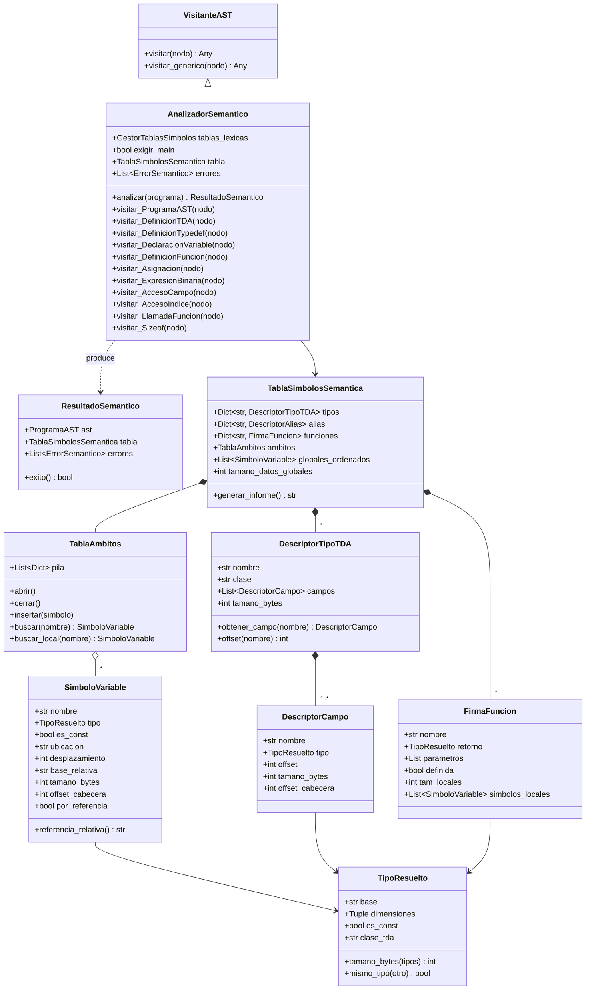
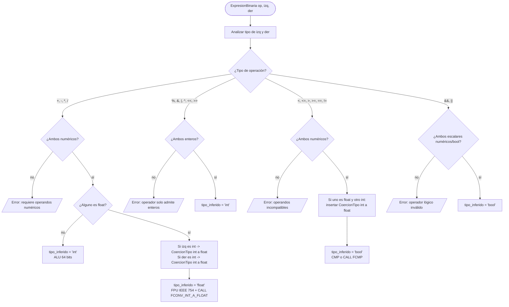

# Universidad Nacional de Colombia
## Lenguajes de Programación — Semestre 2026-2
**Taller # 02:** Análisis sintáctico, semántico y generación de código en YACC — SPL Fase 2 (Enigma-64)  
**Documento Técnico — Módulo: Ajuste Léxico (Literal b), Analizador Semántico (Literales d y e) y Matriz de Modularidad E/S**  
**Autor:** Juan Luis Vergara Novoa (Integrante 4)

---

## 1. Alcance y Responsabilidad Técnica

El presente documento formaliza el diseño, la implementación y la verificación de los entregables asignados al **Integrante 4** para el **Taller # 02** sobre la arquitectura **Enigma-64 (Noctua Systems)**:

1. **Sección 2 del Informe General — Descripción y Justificación del Problema + Matriz de Modularidad E/S:** Análisis formal del paso de la Fase 1 (análisis léxico) a la Fase 2 (análisis sintáctico, semántico y generación de código) y contrato estricto de entrada, transformación y salida de las 8 etapas del SPL.
2. **Literal b — Ajuste del Analizador Léxico (`spl/compilador/lexer.py`):** Incorporación de los literales booleanos (`TRUE_LIT`, `FALSE_LIT`) y de los 18 operadores exigidos por la gramática E-BNF de 13 niveles (`&`, `|`, `^`, `~`, `<<`, `>>`, `++`, `--`, `+=`, `-=`, `*=`, `/=`, `%=`, `&=`, `|=`, `^=`, `<<=`, `>>=`), alineados 1:1 con el contrato `TOKENS_ADICIONALES` / `OPERADORES_ADICIONALES` de `spl/compilador/parser.py`.
3. **Literales d (Parte 3) y e — Analizador Semántico Completo (`spl/compilador/semantico.py`):**
   - Tabla de símbolos jerárquica por ámbitos (`TablaAmbitos`: global → función → bloque / `for` / `case`).
   - Resolución de tipos primitivos, alias (`typedef` con composición de dimensiones a la derecha) y **Tipos de Datos Abstractos (`struct` / `tda`)** con cálculo exacto de *layouts* y *offsets* alineados a 8 bytes (`addr % 8 == 0`).
   - Asignación de direcciones relativas con base explícita: globales respecto a `0x00201000`, locales `[BP - k]` respecto a `R7/BP` (calculando `tam_locales` para `ENTER`), parámetros en `R1..R4` / `[BP + 16 + 8*(i-4)]`, matrices 2D con cabecera `[Base - 16] = F` y `[Base - 8] = C`, y campos de TDA respecto a `Base(instancia)`.
   - Verificación estricta de tipos, *lvalues* modificables, inmutabilidad `const`, prototipos/firmas de funciones, `return`, `case` duplicados, contexto de `break`/`continue` y `sizeof` en tiempo de compilación.
   - **Coerción automática para aritmética IEEE 754 binary64:** inserción explícita de nodos `CoercionTipo('int', 'float', expr)` en el AST ante operaciones/asignaciones/argumentos/retornos mixtos `int → float` y rechazo de truncamiento implícito `float → int`.
4. **Suite de Pruebas Automatizadas (`tests/test_spl/test_semantico_spl.py`)** y actualización controlada de las suites léxicas del Taller # 01.

### Archivos Entregados

| Archivo | Rol en el Sistema |
| :--- | :--- |
| `spl/compilador/lexer.py` | Ajuste del analizador léxico PLY (Literal b): literales booleanos y 18 operadores de bits, incremento/decremento y asignación compuesta. |
| `spl/compilador/semantico.py` | Analizador semántico `AnalizadorSemantico(VisitanteAST)`, `TablaSimbolosSemantica`, `TablaAmbitos`, `TipoResuelto`, `DescriptorTipoTDA`, `DescriptorCampo`, `SimboloVariable`, `FirmaFuncion`, `ErrorSemantico` y `ResultadoSemantico`. |
| `spl/compilador/__init__.py` | Exportación pública unificada de las constantes léxicas nuevas y toda la API del analizador semántico. |
| `tests/test_spl/test_semantico_spl.py` | Batería de pruebas unitarias e integrales del analizador semántico (incluyendo los ejemplos del Taller 1 y algoritmos tipo Taller 2). |
| `tests/test_spl/test_lexer_compilador.py` | Pruebas léxicas actualizadas para `TRUE_LIT`/`FALSE_LIT` y operadores extendidos. |
| `tests/test_spl/test_lexer_operadores_literales.py` | Pruebas de *maximal munch* y escenarios actualizados tras promover `&` y `|` a operadores bit a bit legales. |
| `docs/integrantes/informe_integrante4_lexer_semantico.md` | Este documento técnico oficial. |

---

## 2. Descripción y Justificación del Problema (Sección 2 del Informe General)

### 2.1. Del Análisis Léxico al Compilador Completo sobre Enigma-64
En la Fase 1 (Taller # 01) el Sistema de Procesamiento del Lenguaje (SPL) de **Enigma-64** resolvió el preprocesamiento (`#include`, `#define`, `#ifdef`), la tokenización del lenguaje de alto nivel y del ensamblador, las tablas de literales (`tablaID`, `tablaNum` con empaquetado IEEE 754 binary64 y `tablaString`) y el enlace de módulos objeto reubicables. Sin embargo, un flujo de tokens aislado no puede validar la estructura gramatical de un programa, resolver ámbitos ni traducir construcciones de alto nivel (estructuras de control, funciones, arreglos 1D, matrices 2D, TDA y expresiones `float`) al repertorio de 41 instrucciones de Enigma-64.

La Fase 2 (Taller # 02) cierra esta brecha construyendo el *front-end* sintáctico-semántico y el *back-end* generador de código en PLY (`ply.lex` + `ply.yacc`) bajo tres restricciones arquitectónicas reales del computador **Enigma-64**:

1. **Alineación natural estricta a 8 bytes (`addr % 8 == 0`):** Todo acceso desalineado dispara `STATUS_MISALIGNED` y activa la bandera `M` del registro `SR`. Por ello, todos los tipos escalares (`int`, `float`, `bool`, `char`) se almacenan en palabras completas de 8 bytes, los arreglos ocupan $8 \cdot N$ bytes, las matrices 2D reservan $16 + 8 \cdot F \cdot C$ bytes (cabecera `[Base - 16] = F`, `[Base - 8] = C` compatible con `mat.asm`) y cada campo de un TDA queda alineado automáticamente a múltiplos de 8 bytes.
2. **Separación de aritmética entera (ALU) y punto flotante IEEE 754 (FPU):** Las instrucciones nativas `ADD`/`SUB`/`MUL`/`DIV` operan sobre enteros en complemento a dos de 64 bits, mientras que las operaciones `float` invocan subrutinas de `enigma64/fpu/` (`FADD`, `FSUB`, `FMUL`, `FDIV`, `FCMP`, `FCONV_INT_A_FLOAT`). Sin un analizador semántico que infiera tipos y haga explícita cada promoción `int → float` mediante `CoercionTipo`, el generador de código no podría decidir si emitir instrucciones de ALU o llamadas `CALL` a la FPU.
3. **Trazabilidad modular y direcciones relativas explícitas:** Atendiendo la retroalimentación de la sustentación del Taller # 01, cada etapa del SPL define exactamente qué entra y qué sale, y toda dirección generada o calculada declara su base de referencia (`0x00201000` para `.data`, `R7/BP` para el marco local, `R1..R4` para argumentos y `Base(instancia)` para campos de TDA).

### 2.2. Matriz de Modularidad: Contratos Estrictos de Entrada y Salida por Módulo

| Etapa / Módulo | Entrada Exacta (Archivo / Estructura) | Transformación Interna | Salida Exacta (Archivo / Estructura) |
| :--- | :--- | :--- | :--- |
| **1. Preprocesador** (`spl/preprocesador/`) | Archivo `programa.spl` (UTF-8) + cabeceras `spl/include/*.h` / `*.pre` + macros `-D`. | Resuelve `#include`, expande `#define`, evalúa `#ifdef`/`#endif` y limpia comentarios conservando correspondencia de líneas. | Archivo precompilado `programa.pre` + `ResultadoPreprocesamiento(texto_expandido, mapa_lineas, macros_activas)`. |
| **2. Analizador Léxico** (`spl/compilador/lexer.py`) | Texto limpio proveniente de `programa.pre`. | Tokeniza con `ply.lex` (coincidencia más larga), valida rangos de 64 bits e IEEE 754 binary64 e inserta lexemas únicos en tablas hash. | `List[LexToken]` (`type`, `categoria_codigo`, `subcodigo`, `lineno`, `columna`, `simbolo_idx`) + `GestorTablasSimbolos` + `List[ErrorLexico]`. |
| **3. Analizador Sintáctico** (`spl/compilador/parser.py`) | Flujo `List[LexToken]` de `CompiladorLexer` envuelto por `_FlujoTokens` (`TIPO_ID`). | Ejecuta el autómata LALR(1) de `ply.yacc` (0 conflictos S/R y R/R) y sincroniza errores sintácticos en `p_error`. | `ProgramaAST` jerárquico (`ast_nodos.py`) + `List[ErrorSintactico]`. |
| **4. Analizador Semántico** (`spl/compilador/semantico.py`) | `ProgramaAST` sin tipos resueltos + `GestorTablasSimbolos`. | Construye pila de ámbitos, calcula layouts y *offsets* de TDA/variables a 8 B, valida tipos/aridad/lvalues e inserta `CoercionTipo`. | `ResultadoSemantico(ast anotado, TablaSimbolosSemantica, List[ErrorSemantico])`. |
| **5. Generador de Código** (`spl/compilador/generador.py`) | `ProgramaAST` anotado + `TablaSimbolosSemantica` + `TablaNum` (`patron_ieee754_hex`). | Traduce cada nodo del AST a instrucciones ISA de Enigma-64, emite marcos `ENTER/LEAVE`, llamadas a `enigma64/fpu/` y anota bases relativas. | Archivo `programa.asm` en ensamblador nativo de Enigma-64 con trazabilidad de línea fuente y base de direccionamiento. |
| **6. Ensamblador** (`spl/ensamblador/` / `ensamblar()`) | `programa.asm` y subrutinas de biblioteca (FPU, `vec.asm`, `mat.asm`). | Dos pasadas: construye tabla de etiquetas y codifica instrucciones de 1 a 5 bytes Big-Endian con marcas de reubicación. | Módulo objeto reubicable `programa.obj` (cabecera `EOBJ`, secciones `.text/.data/.bss`, tabla de símbolos y marcas `ABS32/REL16/HI16/LO16`). |
| **7. Enlazador-Cargador** (`spl/enlazador/` + `enigma64/cargador.py`) | Uno o más `.obj`/`.tobj` + dirección base de carga (`0x00200000`). | Resuelve símbolos externos en la ESTAB, aplica reubicaciones relativas y carga la imagen ejecutable en `RAMMemory`. | Imagen `programa.e64` cargada en RAM + volcado binario estricto (`0s` y `1s`) por campos + mapa de direcciones reubicadas. |
| **8. CPU Enigma-64 y Trazador** (`enigma64/cpu.py` + `pipeline.py`) | Estado inicial de `RAMMemory` y `BancoRegistros` (`PC = 0x00200000`, `SP = 0x00400000`). | Ejecuta ciclos `FETCH → DECODE → EXECUTE → MEMORY → WRITE-BACK` hasta `HLT` en modo continuo o `--paso-a-paso`. | Estado final de registros (`R5 = RV`), volcados de RAM y bitácora paso a paso contrastada contra la prueba de escritorio. |

---

## 3. Literal b — Ajustes al Analizador Léxico (`spl/compilador/lexer.py`)

Al integrar la gramática E-BNF oficial (`spl/compilador/gramatica_spl.ebnf`, 13 niveles de precedencia) con el analizador léxico de la Fase 1, se realizaron dos ajustes puntuales y retrocompatibles:

1. **Literales booleanos (`PALABRAS_RESERVADAS_BOOLEANAS`, categoría `CAT_CONSTANTE_BOOLEANA = 165`):**
   - `"true" → TRUE_LIT` (subcódigo `1`), `"false" → FALSE_LIT` (subcódigo `2`).
   - Se clasifican directamente en `t_ID` mediante `PALABRAS_RESERVADAS` sin contaminar `tablaID` (`simbolo_idx = None`).
   - Consecuencia verificada en `escenario2_control_funciones.spl`: `true` y `false` pasan de `ID` a `TRUE_LIT` / `FALSE_LIT` (`tabla_id.total`: `16 → 14`).

2. **18 operadores nuevos del contrato `OPERADORES_ADICIONALES` de `parser.py`:**
   - **Operadores bit a bit y desplazamiento (`CAT_OPERADOR_BIT = 225`):** `&` (`AND_BIT`), `|` (`OR_BIT`), `^` (`XOR_BIT`), `~` (`NOT_BIT`), `<<` (`DESPLAZAR_IZQ`), `>>` (`DESPLAZAR_DER`).
   - **Incremento y decremento (`CAT_OPERADOR_INC_DEC = 235`):** `++` (`INCREMENTO`), `--` (`DECREMENTO`).
   - **Asignación compuesta (`CAT_OPERADOR_ASIGNACION = 230`, subcódigos 2..11):** `+=` (`MAS_ASIGNAR`), `-=` (`MENOS_ASIGNAR`), `*=` (`POR_ASIGNAR`), `/=` (`DIV_ASIGNAR`), `%=` (`MOD_ASIGNAR`), `&=` (`AND_ASIGNAR`), `|=` (`OR_ASIGNAR`), `^=` (`XOR_ASIGNAR`), `<<=` (`DESPLAZAR_IZQ_ASIGNAR`), `>>=` (`DESPLAZAR_DER_ASIGNAR`).
   - **Prioridad *maximal munch* en PLY:** Todas las expresiones regulares de 3 caracteres (`<<=`, `>>=`) tienen longitud mayor que las de 2 caracteres (`<<`, `>>`, `<=`, `>=`, `&&`, `||`, `++`, `--`, `+=`...), y estas a su vez mayor longitud que los operadores de 1 carácter (`&`, `|`, `^`, `~`, `+`, `-`, `*`, `/`, `%`, `<`, `>`, `!`, `=`). Al quedar `&` y `|` como operadores bit a bit válidos de la gramática, se retiró la regla de error `t_OPERADOR_INCOMPLETO` del Taller 1.

---

## 4. Literal d (Parte 3) — Diseño UML del Analizador Semántico y Coerción IEEE 754

### 4.1. Diagrama de Clases de `spl/compilador/semantico.py`



### 4.2. Diagrama de Actividad: Verificación de Expresiones y Coerción Automática IEEE 754



### 4.3. Diagrama de Secuencia: Flujo Preprocesador → Lexer → Parser → Semántico

```mermaid
sequenceDiagram
    participant PRE as Preprocesador (.pre)
    participant LEX as CompiladorLexer (Literal b)
    participant PAR as CompiladorParser (LALR 1)
    participant SEM as AnalizadorSemantico (Int. 4)
    participant GEN as GeneradorCodigoSPL (Int. 5 y 6)

    PRE->>LEX: texto_expandido (.pre)
    LEX->>PAR: List[LexToken] + GestorTablasSimbolos (patron_ieee754_hex)
    PAR->>SEM: ProgramaAST (sin anotaciones de tipo)
    SEM->>SEM: Resolver TDAs (layouts 8B) y typedef
    SEM->>SEM: Asignar offsets (0x00201000 / R7-BP / R1..R4)
    SEM->>SEM: Validar tipos e insertar CoercionTipo('int','float')
    SEM-->>GEN: ResultadoSemantico(ast anotado, TablaSimbolosSemantica)
```

---

## 5. Contrato de Integración para los Integrantes 5 y 6 (`generador.py`)

El generador de código hereda de `VisitanteAST` y recibe `ResultadoSemantico` con todas las decisiones resueltas:

1. **Variables globales (`res.tabla.globales_ordenados`):** Cada `SimboloVariable` expone `desplazamiento` (relativo a `BASE_DATOS_GLOBAL = 0x00201000`), `direccion_absoluta`, `tamano_bytes` y `offset_cabecera` (para matrices 2D donde `[Base - 16] = F` y `[Base - 8] = C`).
2. **Marcos de función (`FirmaFuncion` en `nodo.simbolo`):** `firma.tam_locales` es el argumento directo de `ENTER <tam_locales>`; cada local tiene `desplazamiento < 0` relativo a `R7/BP`, y cada parámetro tiene `base_relativa` (`"R1..R4"` o `"R7/BP"`) y `por_referencia`.
3. **Acceso a campos de TDA (`AccesoCampo`):** `nodo.simbolo` es un `DescriptorCampo` cuyo atributo `offset` es el desplazamiento exacto (múltiplo de 8) relativo a la dirección base de la instancia.
4. **Aritmética IEEE 754:** Cuando `nodo.tipo_inferido == "float"`, emitir llamadas a `enigma64/fpu/` (`FADD`, `FSUB`, `FMUL`, `FDIV`, `FCMP`); cuando aparezca un nodo `CoercionTipo('int', 'float', expr)`, emitir `CALL FCONV_INT_A_FLOAT`. Para literales flotantes, leer el patrón de 64 bits Big-Endian desde `tablas_lexicas.tabla_num.obtener(nodo.simbolo_idx).patron_ieee754_hex`.
5. **`Sizeof`:** `nodo.simbolo` ya contiene el tamaño exacto en bytes como entero constante listo para cargar con `ADDI`.

---

## 6. Verificación Automatizada

- **Suite del analizador semántico (`python -m pytest tests/test_spl/test_semantico_spl.py -q`):** **52 pruebas aprobadas** en 2.71 s (0 fallos, 0 omitidas), incluyendo integración real sobre los 5 escenarios del Taller # 01 y programas completos equivalentes a Euclides, Newton-Raphson IEEE 754 y TDA `RegistroSensor` con `switch-case`.
- **Suite completa del repositorio (`python -m pytest tests -q`):** **2,102 pruebas aprobadas, 1 omitida y 486 subpruebas aprobadas** en 42.68 s (0 fallos), verificando retrocompatibilidad con `test_lexer_compilador.py`, `test_lexer_operadores_literales.py`, `test_parser_spl.py`, `test_parser_control_expresiones.py`, `test_enlazador_binario.py`, `test_pipeline_integracion.py` y `tests/ui/test_ui_aislamiento.py`.

