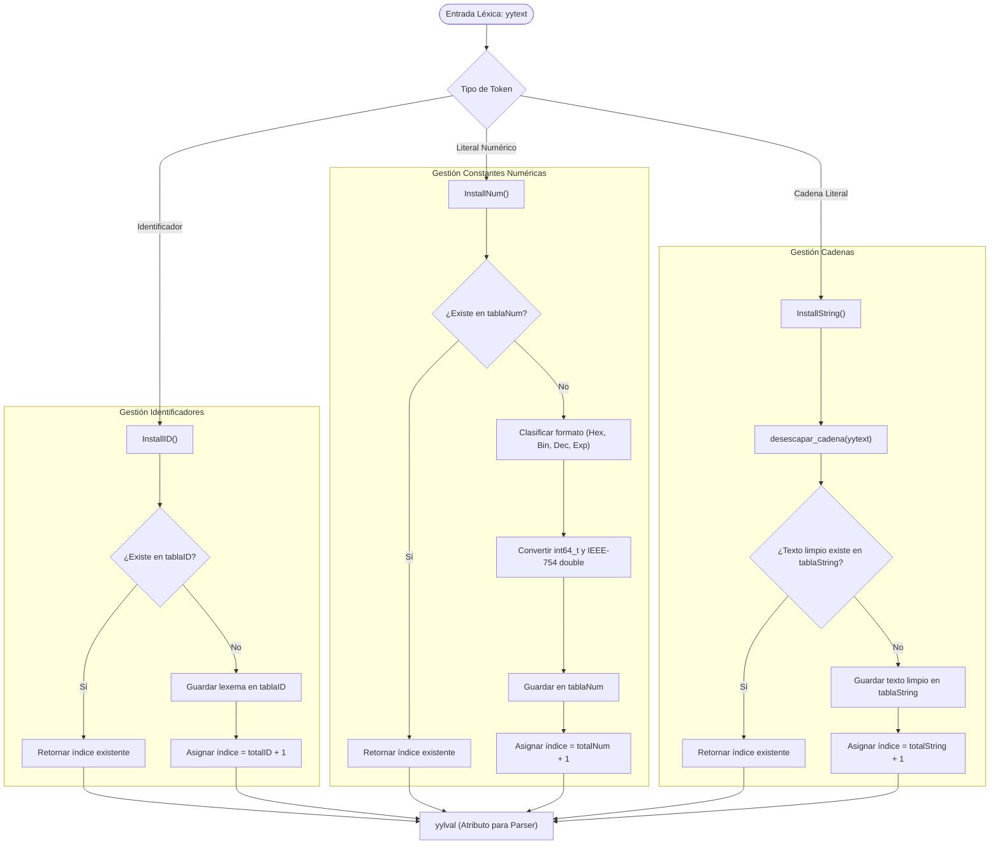

# Universidad Nacional de Colombia
## Lenguajes de Programación — Semestre 2026-2
**Taller # 01:** Análisis Léxico LEX — Sistema de Procesamiento del Lenguaje (SPL) para Enigma-64  
**Documento Técnico — Módulo: Tabla de Símbolos & Tablas de Literales (ID, NUMBER, STRING)**  
**Autor:** Integrante 6 (Tabla de Símbolos & Tablas de Literales)

---

## 1. Alcance y Responsabilidad Técnica

El presente documento formaliza el análisis, diseño, implementación y verificación de las responsabilidades asignadas al **Integrante 6** para la primera fase del Sistema de Procesamiento del Lenguaje (SPL) del computador de 64 bits **Enigma-64**:

1. **Diseño e implementación en C/C++ y Python de las estructuras de datos de las tablas del compilador:**
   - **Tabla de Identificadores (`tablaID`, Categoría 150):** Estructura de almacenamiento sin duplicados, búsqueda secuencial y asignación correlativa de índices base 1 mediante `InstallID()`.
   - **Tabla de Constantes Numéricas (`tablaNum`, Categoría 160):** Almacenamiento unificado de enteros con y sin signo de 64 bits (`int64_t`/`uint64_t`) y constantes reales en formato IEEE 754 de doble precisión de 64 bits (binary64) mediante `InstallNum()`, con soporte para bases decimal, hexadecimal (`0x...`), binaria (`0b...`) y notación científica exponencial (`1.5E3`, `0.05e-2`).
   - **Tabla de Cadenas Literales (`tablaString`, Categoría 170):** Reconocimiento, des-comillado y resolución de secuencias de escape mediante el algoritmo determinista `desescapar_cadena()`, deduplicando sobre el texto limpio mediante `InstallString()`.
2. **Funciones de Consulta (`lookup`) y Diagnóstico:** Funciones para inspección sin inserción (`BuscarID`, `BuscarNum`, `BuscarString`), consulta por índice (`ObtenerEntrada...`) y volcado estructurado alineado en consola (`imprimirVolcadoTablas()`).
3. **Compatibilidad Nativa con FLEX y Entorno Python:** Enlace transparente con la variable global `yytext` de FLEX/Lex, y entrega simultánea del módulo en Python (`spl.compilador.tablas`) con batería completa de pruebas unitarias automatizadas.

### Componentes Entregados

| Archivo | Rol en el Sistema | Contenido Principal |
| :--- | :--- | :--- |
| `spl/compilador/tablas_simbolos.h` | Cabecera C/C++ pública | Declaración de `EntradaID`, `EntradaNum`, `EntradaString`, enums de tipos numéricos y prototipos de `InstallID`, `InstallNum`, `InstallString`, `lookup` y utilidades. |
| `spl/compilador/tablas_simbolos.c` | Implementación nativa en ANSI C | Lógica de inserción, deduplicación, parsing numérico de 64 bits / IEEE 754, algoritmo de des-escape y funciones de volcado en consola. |
| `spl/compilador/test_tablas.c` | Suite de pruebas unitarias en C | Batería exhaustiva de 4 pruebas formales y 47 aserciones con GCC para validar deduplicación y casos límite. |
| `spl/compilador/Makefile` | Automatización de compilación C | Reglas `all`, `test` y `clean` para compilación estricta con `-Wall -Wextra -std=c11 -O2`. |
| `spl/compilador/__init__.py` | Módulo Python exportador | Exportación pública de clases y funciones del compilador. |
| `spl/compilador/tablas.py` | Implementación en Python | Clases `TablaID`, `TablaNum`, `TablaString`, `GestorTablasSimbolos`, des-escape determinista y empaquetado IEEE 754 con `struct`. |
| `tests/test_spl/test_tablas.py` | Suite de pruebas unitarias en Python | 19 pruebas en `pytest` cubriendo des-escape, enteros 64-bit, flotantes IEEE 754 y deduplicación. |

---

## 2. Marco Teórico y Justificación del Diseño

De acuerdo con el modelo de compiladores del libro guía (*Compilers: Principles, Techniques, and Tools*, 2da edición, Aho, Lam, Sethi y Ullman, Sección 3.4 y Figura 3.23), el analizador léxico (*scanner*) agrupa los caracteres del flujo de entrada en tokens. Cuando un token posee atributos que deben preservarse para las etapas posteriores (análisis sintáctico, chequeo de tipos, generación de código intermedio), dicho atributo no se devuelve como una copia redundante de texto, sino como un **índice numérico entero** (`yylval`) que referencia una posición fija en la **Tabla de Símbolos**.

### Principios Fundamentales Adoptados:

1. **Deduplicación Estricta:** Si una variable `contador` o una constante `1.5E3` aparece 100 veces en el código fuente, la memoria del compilador almacena una única entrada y todas las apariciones comparten el mismo índice `yylval`.
2. **Indexación Base 1:** Los índices correlativos inician en `1`. En la convención canónica de traductores, el valor `0` queda reservado como indicador de *nulo*, *no encontrado* o *error*.
3. **Independencia de Tablas:** Las tres categorías con almacenamiento dinámico (`ID = 150`, `NUMBER = 160`, `STRING = 170`) disponen de estructuras de datos independientes. Esto evita colisiones entre una variable llamada `EXIT` (en `tablaID`) y una cadena literal `"EXIT"` (en `tablaString`).
4. **Almacenamiento de Reales IEEE 754 de 64 bits (Enigma-64):** El computador Enigma-64 posee una arquitectura de 64 bits con FPU de doble precisión (binary64). Por tanto, la tabla de números no solo guarda el texto bruto, sino su valor numérico real exacto en tipo `double` de C / `float` de Python (53 bits de mantisa, 11 de exponente y 1 de signo).

---

## 3. Especificación Técnica de las Tablas de Símbolos

### 3.1. Tabla de Identificadores (`tablaID`, Categoría 150)

Registra cada nombre de variable, función o identificador de tipo TDA sin duplicados.

```c
typedef struct {
    int indice;                 /* Posición correlativa 1-based (yylval) */
    char lexema[MAX_LEXEMA_ID]; /* Nombre literal del identificador */
} EntradaID;
```

#### Algoritmo `InstallID()`
```text
Función InstallID(lexema):
    Para cada i de 0 a totalID - 1:
        Si tablaID[i].lexema == lexema:
            Retornar tablaID[i].indice   // Deduplicación exitosa
    Si totalID >= MAX_SIMBOLOS:
        Reportar error de desbordamiento por stderr
        Retornar -1
    tablaID[totalID].indice = totalID + 1
    tablaID[totalID].lexema = lexema
    totalID = totalID + 1
    Retornar tablaID[totalID - 1].indice
```

---

### 3.2. Tabla de Constantes Numéricas (`tablaNum`, Categoría 160)

Diseñada para soportar la riqueza numérica de la arquitectura Enigma-64 (cálculo de enteros de 64 bits, direccionamiento MMIO y aritmética de punto flotante de la FPU):

```c
typedef enum {
    NUM_ENTERO_DECIMAL = 1,
    NUM_ENTERO_HEX     = 2,
    NUM_ENTERO_BIN     = 3,
    NUM_REAL_DECIMAL   = 4,
    NUM_REAL_CIENTIFICO= 5
} TipoNumero;

typedef struct {
    int indice;
    char lexema[MAX_LEXEMA_NUM];
    TipoNumero tipo;
    int64_t valor_int;      /* Entero con signo 64-bit */
    uint64_t valor_uint;    /* Entero sin signo 64-bit (para máscaras y MMIO) */
    double valor_float;     /* IEEE 754 binary64 de doble precisión */
} EntradaNum;
```

#### Reglas de Clasificación y Conversión:
- **Prefijo `0x` / `0X`:** Clasificado como `NUM_ENTERO_HEX`. Se analiza mediante `strtoull(lexema, NULL, 16)`, preservando enteros de hasta 64 bits (por ejemplo, direcciones de periféricos como `0xFF000000`).
- **Prefijo `0b` / `0B`:** Clasificado como `NUM_ENTERO_BIN`. Se decodifica bit a bit.
- **Presencia de exponente (`e` / `E`):** Clasificado como `NUM_REAL_CIENTIFICO`. Convertido mediante `strtod()` a estándar IEEE 754 de 64 bits.
- **Presencia de punto decimal (`.`):** Clasificado como `NUM_REAL_DECIMAL`.
- **Dígitos simples:** Clasificado como `NUM_ENTERO_DECIMAL`. Se convierte mediante `strtoll(lexema, NULL, 10)`.

---

### 3.3. Tabla de Cadenas Literales (`tablaString`, Categoría 170)

Almacena literales de texto delimitados originalmente por comillas dobles, pero procesados algorítmicamente para suprimir comillas exteriores y resolver secuencias de escape.

```c
typedef struct {
    int indice;
    char texto[MAX_TEXTO_STRING]; /* Texto limpio des-escapado */
    size_t longitud;              /* Longitud en bytes */
} EntradaString;
```

#### Algoritmo de Des-comillado y Des-escape (`desescapar_cadena`)
El algoritmo recorre la cadena una sola vez en tiempo lineal $\mathcal{O}(N)$:
1. Verifica que la cadena posea al menos dos caracteres y comience/termine con comilla doble (`"`).
2. El puntero de lectura avanza desde `i = 1` hasta `len - 2` (omitiendo comillas límite).
3. Ante un carácter de escape `\`:
   - Si el carácter siguiente es `"` $\to$ inserta `"` en destino.
   - Si es `\` $\to$ inserta `\`.
   - Si es `n` $\to$ inserta salto de línea `\n` (`0x0A`).
   - Si es `t` $\to$ inserta tabulación `\t` (`0x09`).
   - Si es `r` $\to$ inserta retorno de carro `\r` (`0x0D`).
   - Si es `0` $\to$ inserta byte nulo `\0`.
4. El búfer de destino siempre se termina estrictamente con `\0`, garantizando inmunidad a vulnerabilidades de desbordamiento de búfer (*buffer overflow*).

---

## 4. Diagrama de Flujo del Proceso de Inserción y Deduplicación



---

## 5. Verificación Experimental y Pruebas Unitarias

### 5.1. Batería de Pruebas en C (`test_tablas.c` con GCC 15.1.0)
La compilación estricta y ejecución directa arrojó resultados perfectos sin advertencias:

```text
========================================================================
 BATERIA DE PRUEBAS UNITARIAS: TABLAS DE SIMBOLOS Y LITERALES (SPL C)   
========================================================================

[TEST 1] Probando Tabla de Identificadores (tablaID)...
  -> OK (Deduplicacion e indexacion base 1 verificadas)
[TEST 2] Probando Tabla de Constantes Numericas (tablaNum - IEEE 754 y 64-bit)...
  -> OK (Enteros 64 bits y flotantes IEEE 754 verificados)
[TEST 3] Probando Tabla de Cadenas Literales (tablaString y des-escape)...
  -> OK (Des-escape determinista y deduplicacion limpia verificados)
[TEST 4] Probando llamadas compatibles con FLEX (InstallID/InstallNum/InstallString)...
  -> OK (Compatibilidad nativa con FLEX y yytext validada)

========================================================================================
                 ESTADO FINAL DE LAS TABLAS DE SIMBOLOS (ENIGMA-64)                     
========================================================================================

* Tabla de Identificadores (tablaID, Categoria 150):
+--------+------------------------------------------------+
| Indice | Lexema                                         |
+--------+------------------------------------------------+
| 1      | variable_global                                |
+--------+------------------------------------------------+
Total de identificadores registrados: 1

* Tabla de Constantes Numericas (tablaNum, Categoria 160):
+--------+----------------+---------------------+---------------------+----------------------+
| Indice | Lexema Literal | Formato Enigma-64   | Valor Entero 64-bit | Real IEEE 754 (64b)  |
+--------+----------------+---------------------+---------------------+----------------------+
| 1      | 3.141592653589793 | REAL_DEC (IEEE-754) | 3                   | 3.141592654          |
+--------+----------------+---------------------+---------------------+----------------------+
Total de constantes numericas registradas: 1

* Tabla de Cadenas de Texto (tablaString, Categoria 170):
+--------+------------------------------------------------+----------+
| Indice | Texto limpio (des-escapado)                    | Longitud |
+--------+------------------------------------------------+----------+
| 1      | Enigma-64\nSPL                                 | 13       |
+--------+------------------------------------------------+----------+
Total de cadenas de texto registradas: 1
========================================================================================

========================================================================
 TODAS LAS PRUEBAS COMPLETADAS CON EXITO!
 Pruebas modulares: 4 | Aserciones formales: 47 | Fallos: 0
========================================================================
```

### 5.2. Batería de Pruebas en Python (`tests/test_spl/test_tablas.py` con Pytest)
Se validaron 19 escenarios unitarios de borde (cadenas vacías, secuencias malformadas, deduplicación de números exponenciales y enteros 64 bits):

```text
tests/test_spl/test_tablas.py ................... [100%]
19 passed in 0.07s
```

---

## 6. Guía de Integración para los Demás Integrantes

### Para los Integrantes 4 y 5 (Compilador: Vocabulario, Operadores y Literales):
En sus reglas léxicas de FLEX (`.l`), simplemente incluyan la cabecera:
```c
%{
#include "tablas_simbolos.h"
%}
```
Y dentro de las acciones semánticas asociadas a las expresiones regulares:
```c
{id}      { yylval = InstallID();     return ID; }
{numero}  { yylval = InstallNum();    return NUMBER; }
{cadena}  { yylval = InstallString(); return STRING; }
```

Si están utilizando la versión en Python con PLY (`lex.py`):
```python
from spl.compilador import GestorTablasSimbolos

gestor = GestorTablasSimbolos()

def t_ID(t):
    r'[a-zA-Z_][a-zA-Z0-9_]*'
    t.value = gestor.install_id(t.value)
    return t

def t_NUMBER(t):
    r'0[xX][0-9a-fA-F]+|[0-9]+(\.[0-9]+)?([eE][+-]?[0-9]+)?'
    t.value = gestor.install_num(t.value)
    return t

def t_STRING(t):
    r'\"([^\"\\\r\n]|\\.)*\"'
    t.value = gestor.install_string(t.value)
    return t
```

### Para el Integrante 7 (Driver Principal y Pipeline):
Al culminar el análisis léxico o la compilación, pueden volcar el estado estructurado de todas las tablas con una sola línea de código:
- En C: `imprimirVolcadoTablas();`
- En Python: `print(gestor.generar_volcado_texto())`
